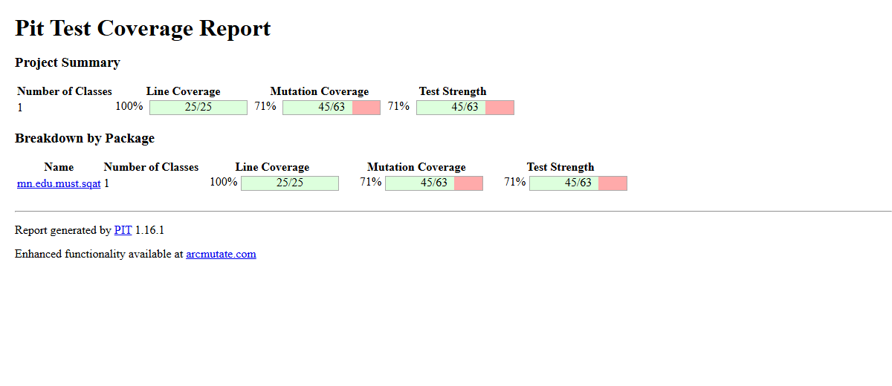
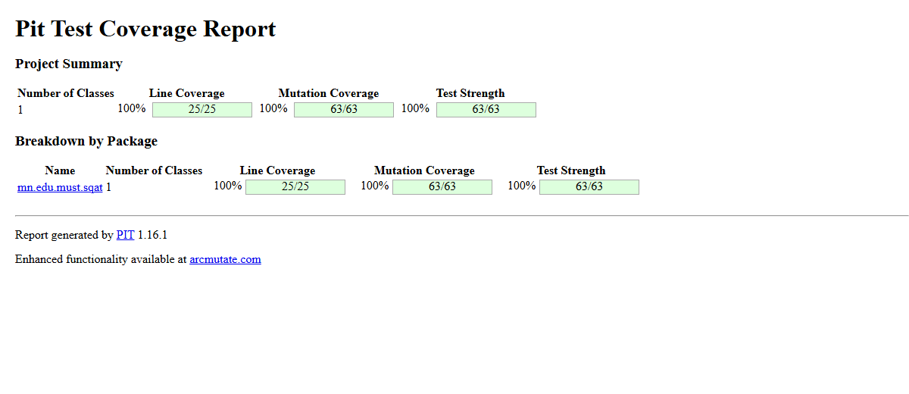
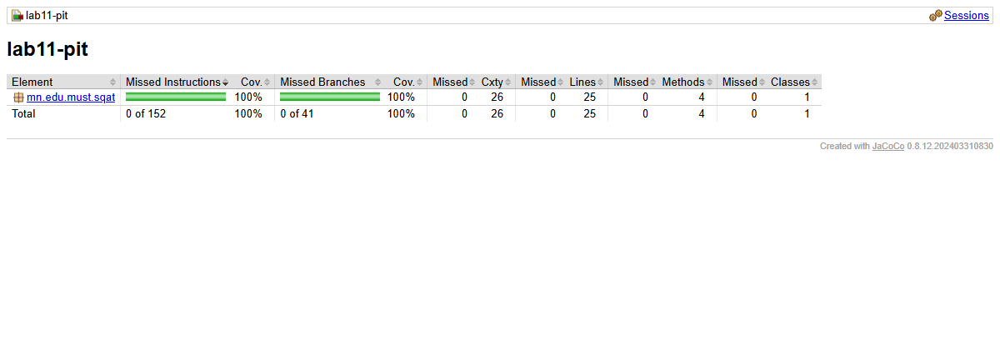

# Лаборатори №11: Mutation testing — PIT-ээр тестийн чанараа хэмжих

**F.CSA313 — Программ хангамжийн чанарын баталгаа ба тест (2026)**

| | |
|---|---|
| **Овог нэр** | А.Төгөлдөр |
| **Оюутны код** | B242270001 |

### Орчин (`results/env.txt`)

Бүх хэмжилтийг Windows 11 дээрх **WSL2 (Ubuntu)** орчинд ажиллуулсан.

```
$ java -version
openjdk version "17.0.20.1" 2026-08-18
OpenJDK Runtime Environment (build 17.0.20.1+1-1-26.04-Ubuntu)
OpenJDK 64-Bit Server VM (build 17.0.20.1+1-1-26.04-Ubuntu, mixed mode, sharing)

$ mvn -version
Apache Maven 3.9.12
Maven home: /usr/share/maven
Java version: 17.0.20.1, vendor: Ubuntu, runtime: /usr/lib/jvm/java-17-openjdk-amd64
Default locale: en, platform encoding: UTF-8
OS name: "linux", version: "6.18.33.2-microsoft-standard-wsl2", arch: "amd64", family: "unix"
```

> **Тэмдэглэл (орчны асуудлууд):**
> 1. WSL-ийн анхдагч Java 25 дээр PIT 1.16.1 нэг ч мутант үүсгэж чадаагүй (`No mutations found`). Тиймээс `JAVA_HOME=/usr/lib/jvm/java-17-openjdk-amd64` болгож Java 17-оор ажиллуулсан.
> 2. Миний локал хавтасны замд кирилл үсэг (`Программ хангамжийн...`) байгаа үед PIT мөн `No mutations found` гэж унасан. Үүнийг тойрохын тулд PIT-ийг ASCII замтай хавтас (`~/lab11-pit`) руу `pom.xml` + `src/`-ийг хуулж ажиллуулсан. Clone хийсэн хавтасны зам ASCII бол ямар нэг тохиргоо шаардлагагүй.

### Ажиллуулах

```bash
export JAVA_HOME=/usr/lib/jvm/java-17-openjdk-amd64   # Java 17+ (PIT 1.16.1)
mvn clean verify                                       # JUnit + JaCoCo
mvn test-compile org.pitest:pitest-maven:mutationCoverage   # PIT -> target/pit-reports/index.html
```

---

## 1. Эхний хэмжилт (starter тестийн багц)

### JaCoCo — Line 100% (25/25), Branch 38/41

`results/jacoco-start.csv`:

```
LINE_MISSED=0, LINE_COVERED=25, BRANCH_MISSED=3, BRANCH_COVERED=38
```


### PIT — Mutation Coverage 27% (17/63)

`results/pit-start.txt`:

```
>> Generated 63 mutations Killed 17 (27%)
>> Mutations with no coverage 0. Test strength 27%
```


### Ажиглалт: Line Coverage ба Mutation Coverage-ийн зөрүү

JaCoCo мөр бүрийг 100% (25/25) ажилласан гэж харуулж байгаа ч PIT-ийн 63 мутантаас ердөө 17 нь (27%) алагдсан. Энэ нь тестүүд кодыг *ажиллуулж* байгаа боловч гаралтыг нь *шалгахгүй* байна гэсэн үг: `assertNotNull`, `assertTrue(0 <= x <= 100)` зэрэг сул assertion нь `"A"`-г `""` болгох, `100`-г `0` болгох өөрчлөлтийг ч барьж чаддаггүй. Хамралт нь "аль мөр ажилласныг" хэмждэг бол mutation score нь "алдаа гарвал тест унах эсэхийг" хэмждэг. Тиймээс 100% хамралт нь тестийн чанарыг баталгаажуулдаггүй.

---

## A. Амьд мутантуудын ангилал (starter: 46 SURVIVED)

PIT тайлангийн мөр бүрийн дэлгэрэнгүй (ногоон = алагдсан, улаан = амьд):


Мөрийн дугаар нь `ScholarshipCalculator.java`-ийн мөр. Нэг мөрөнд ижил шалтгаантай хэд хэдэн мутант байвал нэгтгэсэн.

| Мөр | Код | Мутаци (PIT-ийн тайлбар) | Тоо | Ангилал | Үндэслэл | Арга хэмжээ (алсан тест) |
|---|---|---|---|---|---|---|
| 20 | `score < 0 \|\| score > 100` | changed conditional boundary (`<` → `<=`, `>` → `>=`) | 2 | Тест дутуу | `letterGrade(0)` ба `letterGrade(100)` хүчинтэй оролт боловч мутантад exception шиддэг тул зан төлөв өөрчлөгддөг. | B2: `letterGrade_boundaries` (0 → "F", 100 → "A") |
| 23 | `score >= 90` | changed conditional boundary (`>=` → `>`) | 1 | Тест дутуу | `score = 90` үед "A"-гийн оронд "B" буцаадаг. | B2: `letterGrade_boundaries` (90 → "A") |
| 24 | `score >= 80` | changed conditional boundary | 1 | Тест дутуу | `score = 80` үед "B"-гийн оронд "C" буцаадаг. | B2: `letterGrade_boundaries` (80 → "B") |
| 25 | `score >= 70` | changed conditional boundary | 1 | Тест дутуу | `score = 70` үед "C"-гийн оронд "D" буцаадаг. | B2: `letterGrade_boundaries` (70 → "C") |
| 26 | `score >= 60` | changed conditional boundary | 1 | Тест дутуу | `score = 60` үед "D"-гийн оронд "F" буцаадаг. | B2: `letterGrade_boundaries` (60 → "D") |
| 23–26 | `if (score >= N)` | removed conditional — replaced comparison check with false / with true | 8 | Тест дутуу | Нөхцлийг үргэлж true/false болгоход буруу үсэг буцдаг, гэхдээ `assertNotNull` үүнийг ялгадаггүй. | B1: `assertEquals("A"...)`; B2: `letterGrade_boundaries` |
| 23–27 | `return "A"/"B"/"C"/"D"/"F"` | replaced return value with "" | 5 | Тест дутуу | `""` нь null биш тул `assertNotNull` давдаг, бодит утга нь өөр. | B1: `letterGrade_returnsExactLetterForAllRanges`; B2 |
| 36 | `switch (letterGrade(s))` | Changed switch default to be first case | 1 | Тест дутуу | Switch-ийн default ба эхний case-ийн үсрэлтийг сольсноор зарим үсэг буруу салаа руу орж голч өөрчлөгддөг; `0 <= gpa <= 4` муж үүнийг барихгүй. | B2: `gpa_singleScore_eachLetter` (үсэг бүрийг тусад нь) |
| 38 | `total += 3` (B) | Replaced double addition with subtraction | 1 | Тест дутуу | B үсэг +3-ын оронд −3 болгож голчийг өөрчилдөг; муж шалгалт үүнийг барихгүй. | B1: `gpa_returnsExactAverage` (3.5); B2: `gpa_allLetters_average` |
| 40 | `total += 1` (D) | Replaced double addition with subtraction | 1 | Тест дутуу | D үсэг +1-ийн оронд −1 болгодог (голч 1.5 → 0.5). | B1/B2: `gpa_singleScore_eachLetter` (65 → 1.0) |
| 44 | `return total / scores.length` | replaced double return with 0.0d | 1 | Тест дутуу | 0.0 нь `[0, 4]` мужид багтдаг тул сул assertion давдаг, бодит голч өөр. | B1: `gpa_returnsExactAverage` |
| 48 | `gpa < 0 \|\| gpa > 4 \|\| credits < 0` | changed conditional boundary (`gpa < 0` → `<= 0`, `credits < 0` → `<= 0`) | 2 | Тест дутуу | gpa = 0 ба credits = 0 хүчинтэй оролт боловч мутантад exception шиддэг. | B2: `scholarship_gpaZero_isValid`, `scholarship_exactly30_gets50` (credits = 0) |
| 48 | дээрхтэй ижил | removed conditional — replaced comparison check with true | 1 | Тест дутуу | Хязгаарын шалгалтын нэг хэсгийг алгасахад хүчинтэй оролт exception шиддэг. | B2: `scholarship_exactly38and15_gets100` |
| 51 | `if (hasViolation) return 0` | removed conditional — replaced equality check with false / true | 2 | Тест дутуу | Зөрчилтэй оюутан 100% авах, эсвэл бүх оюутан 0% авах болдог; муж шалгалт `[0, 100]` хоёуланг нь давдаг. | B1: `scholarship_returnsExactPercent`; B2: `scholarship_violation_alwaysZero` |
| 52 | `gpa >= 3.8 && credits >= 15` | changed conditional boundary (`>=` → `>`) ×2 | 2 | Тест дутуу | Яг 3.8 / 15-тай оюутан 100-ын оронд 70 авдаг. | B2: `scholarship_exactly38and15_gets100` |
| 52 | дээрхтэй ижил | removed conditional — with false ×2 / with true ×2 | 4 | Тест дутуу | Нэг нөхцлийг алгасахад кредит хүрэхгүй (3.8, 14) оюутан 100 авах, эсвэл 100 авах ёстой нь 70 авна. | B1 + B2: `scholarship_38butCredits14_gets70` |
| 53 | `gpa >= 3.4 && credits >= 12` | changed conditional boundary ×2 | 2 | Тест дутуу | Яг 3.4 / 12-той оюутан 70-ын оронд 50 авдаг. | B2: `scholarship_exactly34and12_gets70` |
| 53 | дээрхтэй ижил | removed conditional — with false ×2 / with true ×2 | 4 | Тест дутуу | (3.8, 14) эсвэл (3.4, 11) оюутны дүн өөрчлөгддөг. | B2: `scholarship_38butCredits14_gets70`, `scholarship_34butCredits11_gets50` |
| 54 | `gpa >= 3.0` | changed conditional boundary | 1 | Тест дутуу | Яг 3.0-той оюутан 50-ын оронд 0 авдаг. | B2: `scholarship_exactly30_gets50` |
| 54 | дээрхтэй ижил | removed conditional — with false / with true | 2 | Тест дутуу | 3.0-аас доош оюутан 50 авах, эсвэл 3.0+ оюутан 0 авах болдог. | B2: `scholarship_justBelow30_gets0`, `scholarship_34butCredits11_gets50` |
| 52–54 | `return 100 / 70 / 50` | replaced int return with 0 | 3 | Тест дутуу | 0 нь `[0, 100]` мужид багтдаг тул сул assertion давдаг. | B1: `scholarship_returnsExactPercent` |
| | | **Нийт** | **46** | **46 тест дутуу, 0 equivalent** | | |

**Дүгнэлт:** 46 амьд мутант бүгд **тест дутуу** ангилалд орсон, нэг ч **equivalent** мутант байхгүй. Мутант бүрийн хувьд бодит зан төлөвийг өөрчилдөг оролт олдсон. Үүнийг B2-ын дараа 63/63 мутант бүгд алагдсанаар баталсан. Эдгээрээс:
- **conditional boundary** мутантууд (13) нь **зааг утгын тест дутууг** заасан → B2-оор засав;
- **return value / math / removed conditional** мутантууд нь **assertion сул** байгааг заасан → B1-ээр ихэнхийг нь засав.

---

## B. Тестүүдийг хүчтэй болгох

### B1 — Assertion-уудыг яг утгатай болгох

Оролтууд нь starter-тай ижил хэвээр. Зөвхөн дараах сул шалгалтуудыг яг утгатай `assertEquals` болгосон:

| Өмнө (starter) | Дараа (B1) |
|---|---|
| `assertNotNull(calc.letterGrade(95))` | `assertEquals("A", calc.letterGrade(95))` (85→"B", 75→"C", 65→"D", 30→"F") |
| `assertTrue(g1 >= 0 && g1 <= 4)` | `assertEquals(3.5, calc.gpa({95, 85}), 1e-9)`; `{75, 65}` → 1.5; `{40}` → 0.0 |
| `assertTrue(s1 >= 0 && s1 <= 100)` | `assertEquals(100, scholarship(3.9, 16, false))`; 70; 50; 0; 0 (зөрчилтэй) |

`results/pit-B1.txt`:

```
>> Generated 63 mutations Killed 45 (71%)
>> Mutations with no coverage 0. Test strength 71%
```



B1-ийн дараа 18 мутант амьд үлдсэн. Тэдгээр нь бүгд **conditional boundary** болон зааг дээр л ялгарах **removed conditional** мутантууд байсан. Жишээ нь `score >= 90` → `score > 90` мутантыг 95 гэсэн оролт ялгаж чадахгүй, 90-ээр шалгах ёстой.

### B2 — Зааг утгын тестүүд

| Бүлэг | Нэмсэн тест | Утгууд |
|---|---|---|
| letterGrade | `letterGrade_boundaries` (`@ParameterizedTest`) | 100, 90 / 89.99, 80 / 79.99, 70 / 69.99, 60 / 59.99, 0 |
| letterGrade | `letterGrade_justOutsideRange_throws` | −0.01, 100.01 |
| gpa | `gpa_singleScore_eachLetter` | switch-ийн үсэг бүр тусдаа: A=4, B=3, C=2, D=1, F=0 |
| gpa | `gpa_allLetters_average`, `gpa_invalidScoreInside_throws` | {95, 85, 75, 65, 40} → 2.0; {90, 101} → exception |
| scholarship | `..._exactly38and15_gets100`, `..._justBelow38_gets70`, `..._38butCredits14_gets70` | 3.8 / 15 заг |
| scholarship | `..._exactly34and12_gets70`, `..._justBelow34_gets50`, `..._34butCredits11_gets50` | 3.4 / 12 заг |
| scholarship | `..._exactly30_gets50`, `..._justBelow30_gets0` | 3.0 заг |
| scholarship | `..._gpaZero_isValid`, `..._gpaFour_isValid`, `..._creditsZero_isValid`, `invalidInputs` (−0.1) | оролтын хязгаар: gpa 0 ба 4, credits 0 |
| scholarship | `..._violation_alwaysZero` | зөрчилтэй бол дүнгээс үл хамааран 0 |

`results/pit-B2.txt` (эцсийн):

```
>> Generated 63 mutations Killed 63 (100%)
>> Mutations with no coverage 0. Test strength 100%
```



### Хэмжилтийн явц

| Хэмжилт | Файл | Тест | Line Coverage | Mutation Coverage | Test Strength |
|---|---|---|---|---|---|
| Эхлэл (starter) | `results/pit-start.txt` | 6 | 100% (25/25) | **27% (17/63)** | 27% |
| B1 (assertion) | `results/pit-B1.txt` | 6 | 100% (25/25) | **71% (45/63)** | 71% |
| B2 (зааг утга) | `results/pit-B2.txt` | 36 | 100% (25/25) | **100% (63/63)** | 100% |

Line coverage гурван хэмжилтэд ижил 100% байсан ч mutation score 27% → 71% → 100% болж өссөн. Эцсийн JaCoCo нь Branch 41/41 (100%) болсон (`results/jacoco-final.csv`).



Зорилт (≥ 85%) биелсэн. Equivalent мутант байхгүй тул Test Strength = 100%.

---

## C. Гараар нэг мутант — PIT-гүйгээр

### C1. `gpa >= 3.8` → `gpa > 3.8`

`scholarship()`-ийн 52-р мөрийг гараар өөрчилж `mvn test` ажиллуулсан (`results/mvn-test-manual-mutant.txt`):

```diff
-        if (gpa >= 3.8 && credits >= 15) return 100;
+        if (gpa > 3.8 && credits >= 15) return 100;
```

```
[ERROR] Tests run: 36, Failures: 1, Errors: 0, Skipped: 0
[ERROR] Failures:
[ERROR]   ScholarshipCalculatorTest.scholarship_exactly38and15_gets100:131 expected: <100> but was: <70>
[INFO] BUILD FAILURE
```

**Унасан тест:** `scholarship_exactly38and15_gets100` (мөр 131). Яг 3.8 голч, 15 кредиттэй оюутан 100% авах ёстой ч мутантад 70% авсан. Starter багц энэ мутантыг барьдаггүй байсан, учир нь 3.8 заг дээр тест байгаагүй (3.9-өөр л шалгасан). Туршилтын дараа `git restore src/main`-ээр кодыг буцаасан тул мутацитай код commit-д ороогүй.

### C2. Өөрийн зохиосон EQUIVALENT мутант

48-р мөрийн `credits < 0`-ийг `credits <= -1` болгосон:

```diff
-        if (gpa < 0 || gpa > 4 || credits < 0) {
+        if (gpa < 0 || gpa > 4 || credits <= -1) {
```

`mvn test` → `Tests run: 36, Failures: 0` (`results/mvn-test-equivalent-mutant.txt`).

**Тайлбар:** `credits` нь `int` төрөлтэй тул −1 ба 0-ийн хооронд өөр бүхэл тоо байхгүй. Иймээс `credits < 0` ба `credits <= -1` нь ямар ч оролтод яг ижил үр дүн өгнө. Зан төлөв огт өөрчлөгддөггүй тул энэ мутантыг алах (ялгах) тест бичих боломжгүй, өөрөөр хэлбэл энэ нь жинхэнэ **equivalent** мутант юм. Харин `gpa` нь `double` тул `gpa < 0` → `gpa <= -1` гэвэл −0.5 гэх мэт утгаар ялгагдах тул equivalent биш болно.

---

## Дүгнэлт

Code coverage нь тестийн явцад кодын аль мөр, салаа *ажилласныг* хэмждэг бол mutation score нь кодонд алдаа гарвал тест *унах эсэхийг* хэмждэг. Энэ лабд starter багц Line 100% өгч байсан ч 63 мутантын ердөө 27%-ийг алсан нь хамралт ба тестийн чанар хоёр өөр зүйл гэдгийг тод харууллаа. Assertion-уудыг яг утгатай болгоход (B1) score 71% болсон, зааг утгын тестүүд нэмэхэд (B2) 100% болсон. Эндээс "буруу утга буцаах" алдааг сул assertion, "заагт алдах" алдааг зааг тест дутуу байдал нуудаг нь харагдлаа. AI-гаар тест бичүүлэхэд хамралт өндөр боловч `assertNotNull`, муж шалгалт эсвэл одоогийн гаралтыг хуулсан assertion зэрэг сул тест их гардаг. Ийм тест кодыг ажиллуулдаг ч алдааг барьдаггүй. Тиймээс AI-ийн бичсэн тестийг хамралтаар биш mutation score-оор шалгаж, амьд мутант бүрийг (тест дутуу эсвэл equivalent) хүн өөрөө ангилах нь тестийн бодит хүчийг баталгаажуулах хамгийн найдвартай арга юм. Mutation testing нь хамралтыг орлохгүй, харин нөхөж, тестийн "чанарын тоолуур" болдог.

---

## Файлын бүтэц

```
pom.xml
src/main/.../ScholarshipCalculator.java       # өөрчлөгдөөгүй (Starter commit-той ижил)
src/test/.../ScholarshipCalculatorTest.java   # B1 + B2-оор хүчтэй болгосон (36 тест)
results/
  env.txt                         # java -version, mvn -version
  mvn-verify-start.txt            # starter: mvn clean verify
  jacoco-start.csv                # starter: Line 25/25, Branch 38/41
  pit-start.txt                   # 63 mutations Killed 17 (27%)
  pit-B1.txt                      # 63 mutations Killed 45 (71%)
  pit-B2.txt                      # 63 mutations Killed 63 (100%)
  mvn-test-manual-mutant.txt      # C1: gpa > 3.8 -> 1 тест унасан
  mvn-test-equivalent-mutant.txt  # C2: credits <= -1 -> бүх тест давсан
  mvn-verify-final.txt, jacoco-final.csv   # эцсийн JaCoCo: Branch 41/41
images/                           # JaCoCo, PIT тайлангийн зургууд
```
